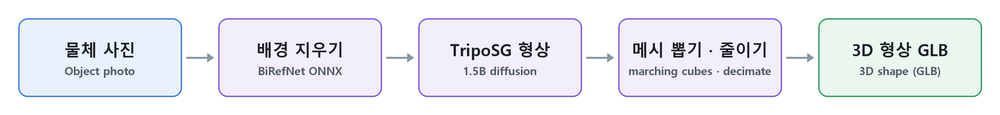

# TripoSG — 이미지 → 3D 형상

PromBoard 커뮤니티 플러그인입니다. 캔버스에 **TripoSG 이미지 → 3D 형상** 노드 하나를 더합니다. 물체 사진 한 장을 넣으면 3D 형상(메시)을 GLB 파일로 만듭니다. 색 · 재질은 입히지 않고 모양만 만들며, 날카로운 모서리와 얇은 부분을 잘 살리는 VAST-AI [TripoSG](https://github.com/VAST-AI-Research/TripoSG)(1.5B)를 씁니다.



노드 안에서 일어나는 순서입니다(`docs/scripts/pipeline.py` 로 그림).

> 미검증: 이 플러그인은 아직 끝까지 돌려 보지 못했습니다(앱에 '검증 안 됨'으로 보입니다). 결과 그림은 실제로 돌려 본 뒤 넣습니다.

## 노드

- 입력: 물체 사진 한 장. 출력: 3D 형상(GLB), 3D 보기로 돌려 볼 수 있습니다.
- 배경 지우기: 자동(투명 PNG 면 그 투명도, 아니면 BiRefNet) · 늘 BiRefNet · 안 함
- 면 수: 5만 · 20만(기본) · 원본 그대로. 원본은 수십만~백만 개라 파일이 큽니다.
- 단계 수(기본 50) · 그림 따르기(기본 7) · 시드

## 받는 것 · 크기

| 받는 것 | 크기 |
|---|---|
| TripoSG 가중치([VAST-AI/TripoSG](https://huggingface.co/VAST-AI/TripoSG), MIT) | 7.95GB |
| BiRefNet ONNX([ZhengPeng7/BiRefNet 릴리스 v1](https://github.com/ZhengPeng7/BiRefNet/releases/tag/v1), MIT) — 배경 지우기가 '안 함'이 아닐 때 | 0.22GB |

플러그인 zip 에는 가중치가 없고, 실행 준비가 원래 출처에서 sha256 을 확인하며 받습니다.

## 알아 둘 것

- NVIDIA 그래픽카드(CUDA) 전용입니다. 윈도우 · 리눅스 잠금 파일만 넣었습니다(맥 없음). 그래픽카드 메모리는 8GB 이상으로 적었습니다(실측 아님).
- 공식 예제와 다른 점: 배경 지우기는 RMBG-1.4(비상업) 대신 BiRefNet(MIT), 메시 뽑기는 diso(소스 빌드만 있는 CUDA 확장)가 필요한 플래시 디코더 대신 scikit-image 마칭 큐브, 면 줄이기는 pymeshlab(GPL) 대신 trimesh quadric 줄이기(fast-simplification, MIT)입니다.
- 물체 하나가 가운데에 크게 나온 사진이 잘 됩니다. 형상을 만들지 못하면 다른 시드로 다시 하라고 알립니다.

## 라이선스

- 플러그인 코드: Apache-2.0([LICENSE](LICENSE), [NOTICE](NOTICE)). 담아 온 TripoSG 코드 · 모델 가중치: MIT.
- 트랜스포머 코드 일부(`nodes/triposg/models/transformers/triposg_transformer.py`)는 Tencent HunyuanDiT 에서 왔고 [Tencent Hunyuan Community License](https://github.com/Tencent/HunyuanDiT/blob/main/LICENSE.txt)(2024-05-14판)를 따릅니다. 그래서 manifest license 는 "MIT AND Apache-2.0" 이고 앱은 설치 때 아래 조건을 보여 주고 확인을 받습니다.
  - EU 에서는 쓸 수 없습니다.
  - 다시 나눠 줄 때는 약관 사본과 Notice 문구를 함께 줍니다(그 파일 머리와 NOTICE 에 담았습니다).
  - 약관의 사용 제한(Acceptable Use Policy)을 지키고 받는 사람에게도 알립니다.
  - 그 판 공개일에 월 이용자가 1억 명을 넘던 회사는 Tencent 의 허락을 따로 받아야 합니다.

## 설치

1. PromBoard(앱 1.0.3 이상) → 플러그인 매니저 → 커뮤니티 플러그인 → 둘러보기에서 설치합니다.
2. 코드가 든 플러그인이라 제한 모드를 끄고 플러그인을 켭니다.
3. 처음 실행 전 실행 준비가 파이썬 패키지와 가중치(약 8.2GB)를 받습니다.
4. 캔버스 빈 곳을 오른쪽 클릭하면 메뉴 맨 아래 플러그인 묶음에 노드가 있습니다.

## 플러그인 만드는 사람을 위한 메모

```
manifest.json                  플러그인 정보 · 노드(layout single, views orbit3d) · 받는 모델
nodes/main.py                  NODES = {"image-to-shape": 함수} — 진행률 · 취소 · 메모리 부족 알림
nodes/cutout.py                BiRefNet ONNX 로 배경 지우기(onnxruntime)
nodes/triposg/                 VAST-AI-Research/TripoSG 의 triposg 패키지(바꾼 곳은 NOTICE)
nodes/requirements-*.txt       파이썬 패키지 잠금 파일(torch 는 앱이 고정한 2.8.0)
docs/scripts/                  README 그림 만드는 스크립트(GLB → three.js 렌더 · 움짤). 플러그인 zip 에는 넣지 않는다
```

---

## English

A PromBoard community plugin. It adds one **TripoSG image → 3D shape** node: give it one photo of an object and it writes a 3D shape (mesh) as GLB, geometry only, no color or material. It uses VAST-AI [TripoSG](https://github.com/VAST-AI-Research/TripoSG) (1.5B), which keeps sharp edges and thin parts well.


What happens inside the node, in order (drawn by `docs/scripts/pipeline.py`).

> Not verified: this plugin has not been run end to end yet (the app shows it as unverified). Result images will be added after a real run.

- Input: one object photo. Output: 3D shape (GLB) with an orbit 3D view.
- Settings: background removal (auto: keep a transparent PNG's alpha, otherwise BiRefNet · always BiRefNet · off), face count (50K · 200K default · original), steps (50), image guidance (7), seed.
- Downloads: TripoSG weights ([VAST-AI/TripoSG](https://huggingface.co/VAST-AI/TripoSG), MIT, 7.95 GB) and, unless background removal is off, the BiRefNet ONNX model (GitHub release v1, MIT, 0.22 GB). They are not in the zip and are checked by sha256.
- NVIDIA GPUs (CUDA) only; lock files for Windows and Linux (no macOS). GPU memory is listed as 8 GB (not measured).
- Differences from the official example: BiRefNet (MIT) instead of RMBG-1.4 (non-commercial) for background removal, scikit-image marching cubes instead of the flash decoder that needs diso (a source-only CUDA extension), and trimesh quadric decimation (fast-simplification, MIT) instead of pymeshlab (GPL).
- Plugin code is Apache-2.0; the bundled TripoSG code and the weights are MIT. Part of the transformer code comes from Tencent HunyuanDiT and is under the [Tencent Hunyuan Community License](https://github.com/Tencent/HunyuanDiT/blob/main/LICENSE.txt) (2024-05-14): it may not be used in the EU, redistribution must include the agreement and its Notice text (both are in that file's header and in NOTICE), the Acceptable Use Policy applies and must be passed on, and companies with more than 100 million monthly active users on that release date need a separate license from Tencent. The app shows these conditions and asks for confirmation at install time.
- Install: PromBoard (app 1.0.3 or later) → Plugin Manager → Community plugins → Browse → install, turn off Restricted mode and enable the plugin. The first prepare downloads the Python packages and weights (about 8.2 GB).

The plugin texts in the app are Korean only for now (the manifest takes a single language).
